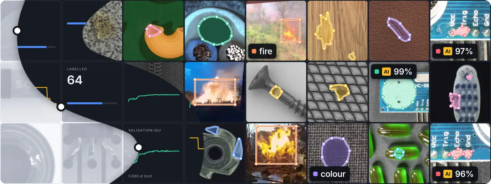
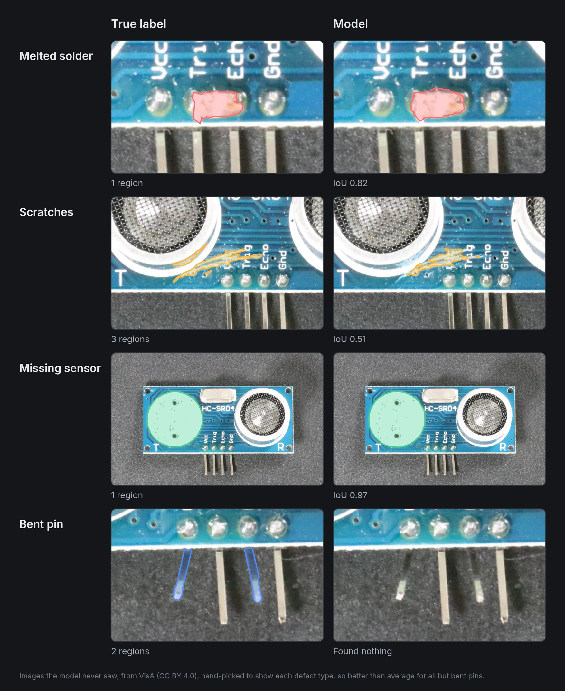
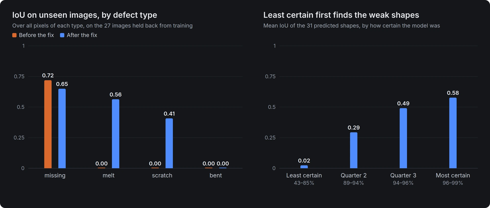

<p align="center">
  <picture>
    <source media="(prefers-color-scheme: dark)" srcset="docs/brand/seamline-logo-on-dark.svg">
    
  </picture>
</p>

<p align="center"><b>Label images and train segmentation models in one desktop app, on your own machines.</b></p>

<p align="center">
  <a href="https://github.com/jakhon37/Seamline/actions/workflows/tests.yml"></a>
  <a href="https://github.com/jakhon37/Seamline/actions/workflows/lint.yml"></a>
  <a href="LICENSE"></a>
</p>

<picture>
  <source media="(max-width: 700px)" srcset="docs/media/banner-phone.webp">
  <source media="(prefers-reduced-motion: reduce)" srcset="docs/media/banner.webp">
  
</picture>

Label some images, train, let the model label the rest, review what it proposed, least certain first, and train again on what you accepted. It all stays on your own machines: labels are plain LabelMe files beside your images, and training runs on this computer or on your GPU machine over SSH.

- **Review ordered by uncertainty.** Every proposed shape gets a confidence score, and you can work through the least certain first, accepting, rejecting or skipping by keyboard.
- **Detached remote training.** A run on your GPU machine keeps going if you close the app or lose the connection, and the app picks it back up.
- **Tile pyramids for large images.** The viewer draws only the tiles on screen, from a pyramid built once with libvips.
- **mySegLib underneath.** Training goes through the library in this repo, built on PyTorch and segmentation_models_pytorch. It also works on its own, with 9 architectures, multi-GPU DDP, chunked inference and ONNX export.

Seamline pairs with [Seamtag](https://github.com/jakhon37/Seamtag), a label-only app with labelme's and LabelImg's tools and AI that outlines objects from a click or a box. Seamline trains on every shape with an area that Seamtag saves whose label is one of its classes, in the folder and its subfolders: polygons, rectangles, rotated boxes, circles and masks in LabelMe JSON, and boxes in Pascal VOC, YOLO and CreateML. Labels new to the folder join the classes with **Add as classes** on the Train page. Seamline's own editor is simpler: it reshapes polygons and rectangles, and keeps every other shape intact. **Label in Seamtag** opens the folder in Seamtag's fuller editor, and **Export for Seamtag** gives Seamtag a trained run to pre-label with. With Seamtag 3.3 or later, both apps can have one folder open at once without writing over each other's labels or classes.


## How it works

<picture>
  <source media="(max-width: 700px)" srcset="docs/media/workflow-phone.webp">
  
</picture>

## See it work


This is the real app on real images, driven by a script. The cursor and key labels are drawn on top for the recording. There's also an [MP4 version](docs/media/demo.mp4).

<table>
  <tr>
    <td width="50%"></td>
    <td width="50%"></td>
  </tr>
  <tr>
    <td><b>Label</b> with polygons, rectangles, a brush and an eraser</td>
    <td><b>Review</b> each proposal: <code>W</code> accept, <code>S</code> reject, <code>Tab</code> skip</td>
  </tr>
  <tr>
    <td></td>
    <td></td>
  </tr>
  <tr>
    <td><b>Touch up</b> with a brush, here joining two pieces of one melted pin</td>
    <td><b>Train</b> on a GPU machine over SSH, and compare runs</td>
  </tr>
</table>

## How it's built


Seamline is an Electron app: a React window, a Node main process, and a Python engine that reports in JSON lines and trains through mySegLib.

- **Scores rank the proposals.** Pre-labelling runs the newest model on every image with no label file, or a LabelMe file with only AI shapes, and saves as it goes. A shape's score is [the model's mean confidence inside it](engine/studio.py), which is good for ranking but isn't a probability. Each image's shapes are reviewed least certain first, and the **Least certain first** order sorts the images the same way. Proposals stay out of training until you accept or edit them.
- **Remote runs outlive the app.** [The app](app/src/main/index.ts) checks the machine's GPU and disk, uploads the dataset with rsync and starts training with `setsid nohup`. The run writes its progress to a file the app reads every 3 seconds, so closing the app, opening another folder or losing the connection doesn't touch it. When the project opens, the app reattaches. When the run ends, the best model comes back and the run's files are removed from the machine. [A stand-in for the GPU machine](app/e2e/fake_gpu.ts) tests the failure cases without needing a GPU, and the normal path has run on a real GTX 1080 Ti.
- **Large images open fast.** Large images and TIFFs get a pyramid built once with libvips and reused until the file changes, and the viewer draws only the tiles on screen. On an older PC, a 6050×12300 test TIFF took 8 seconds to build its pyramid, and after that the open call returned in 4 ms.
- **Training goes through mySegLib.** The engine turns label files into masks and tiles, then trains through the library's `scripts/train.py`. The library also works on its own from YAML configs and the command line: see the [library guide](docs/LIBRARY.md).
- **Labels train as Seamtag and labelme read them.** The engine and the app look for each image's labels beside it, in the order Seamtag looks: `name.json` (LabelMe, or a CreateML list), `name.xml` (Pascal VOC), then `name.txt` beside a `classes.txt` (YOLO). The Pascal VOC, YOLO and CreateML readers are ported from LabelImg, and [tests](tests/unit/test_studio_formats.py) compare what the engine reads from LabelImg's own files with what Seamtag's code reads. [Another test](tests/unit/test_studio_shapes.py) checks the mask of each kind of shape with an area against the one labelme 7.9.1's own code draws, pixel for pixel. Lines and points have no area, so the dataset check counts them and leaves them out.
- **Labels are hard to lose.** Each save names its own folder and goes through one ordered queue, the last edit is flushed before the window closes, and a label file that can't be read is flagged and never written over. Nor is one that another app changed since Seamline read it: Seamline compares the file's content before writing, so a change that keeps its size and time counts too, and when it differs Seamline reloads the labels and says so.
- **Runs export for Seamtag.** Export for Seamtag writes a run's model as ONNX, beside a `model.json` that gives its classes, input size, tile and the normalisation it trained with: the settings Seamline's own pre-labelling uses. An export is saved only if onnxruntime's scores match PyTorch's to within 0.001, or 0.1% of the largest score when that's more, and the `model.json` goes last, so Seamtag 3.3 and later, which list exported runs, never list half an export.
- **Geometry checked against an independent model.** The brush and eraser merge and cut polygons with Clipper. [A seeded test](app/e2e/geometry.spec.ts) runs 150 random paint and erase strokes and checks over 10,000 points against an independent model.

## Tested on real images

The screenshots, the demo and these numbers come from real runs on circuit-board photos from the [VisA dataset](https://github.com/amazon-science/spot-diff): four defect types, 64 labelled images, and 27 held back that the model never saw. The model is a Unet with a ResNet-34 encoder, trained through the app on a GTX 1080 Ti. It's one run on a small set, so read the numbers as rough. The scripts and results, and what these runs changed in the training code, are in [`docs/demo`](docs/demo/README.md).

On the 27 unseen images, all with defects, the model found 24 of the 55 defects (at least half of each covered), proposed nothing on 6 images, and reached a mean IoU of 0.41 across the four defect types. That IoU is over all pixels of each type. The app's Best IoU of 0.669 reads higher because it's on validation tiles and averages background in.

**Mostly right when it proposes.** Of the 31 proposals, 24 are on a defect and the right type, 3 are on a defect but the wrong type, and 4 are mostly off any defect. On 30 defect-free boards, it proposed only 1 shape.



These examples are hand-picked to show each defect type, so they're better than average for all but bent pins. The averages are in the chart:



The right-hand chart is the case for reviewing least certain first: low scores go with weak shapes (Spearman 0.73 between score and IoU). It's from only 31 shapes, so treat it as a direction rather than a measurement.

**What it still gets wrong.** With 64 labelled images, the model misses more than half of the defects and never finds a bent pin. A defect the model misses has no shape to review, so you still need to look at the images. How much labelling time this saves hasn't been measured.

## Try it

You need Node 20+ and Python 3.10+. There's no installer yet, and it's only been tested on Linux.

```bash
git clone https://github.com/jakhon37/Seamline.git
cd Seamline
python -m venv .venv && .venv/bin/pip install -r requirements.txt
cd app
npm install
npm run build
npm start
```

Open any folder of images, including one labelled in labelme, LabelImg or Seamtag. [`app/README.md`](app/README.md) has the keyboard shortcuts, how Seamline works with Seamtag, and how to train on a GPU machine. **Label in Seamtag** needs Seamtag, which has installers for Windows, macOS and Linux on [its releases page](https://github.com/jakhon37/Seamtag/releases/latest). Working on one folder in both apps at once needs Seamtag 3.3 or later. On Ubuntu 24.04 and later, install its `.deb`: its AppImage needs `--no-sandbox` there.

## Still to do

- An installer, and testing on Windows and macOS
- A way to mark an image as truly empty, so it counts as labelled: one whose label file had every shape rejected is left out of pre-labelling, but stays under Label
- Training on clean images too: tiles with no defect are skipped today
- Review of the model's worst errors, not just its least certain shapes
- SAM-assisted labelling

## License and credits

MIT, see [LICENSE](LICENSE). Third-party notices are in [THIRD_PARTY_NOTICES.md](THIRD_PARTY_NOTICES.md). The Pascal VOC, YOLO and CreateML readers in [`engine/studio.py`](engine/studio.py) and [`app/src/shared/formats.ts`](app/src/shared/formats.ts) are ported from [LabelImg](https://github.com/HumanSignal/labelImg) under the MIT License, and carry its notice.

Demo images are from [VisA](https://github.com/amazon-science/spot-diff) (Zou et al., ECCV 2022), used under [CC BY 4.0](https://creativecommons.org/licenses/by/4.0/) and shown cropped with labels drawn on them.

The banner at the top also shows images from [MVTec AD](https://www.mvtec.com/company/research/datasets/mvtec-ad) (Bergmann et al., CVPR 2019), under [CC BY-NC-SA 4.0](https://creativecommons.org/licenses/by-nc-sa/4.0/), and from [D-Fire](https://github.com/gaiasd/DFireDataset) (de Venâncio et al., 2022), released under [CC0 1.0](https://creativecommons.org/publicdomain/zero/1.0/). Because it contains MVTec AD images, the banner (`docs/media/banner*.webp`) is shared under CC BY-NC-SA 4.0, not MIT.
