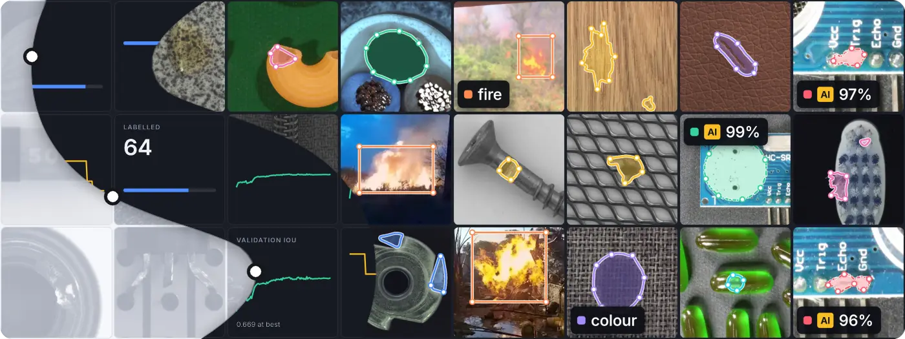
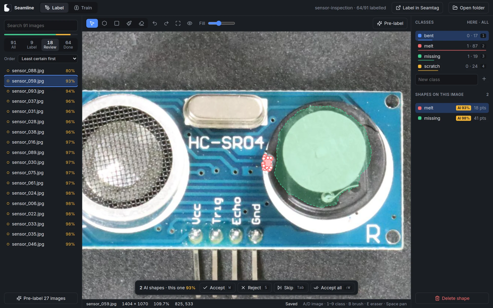
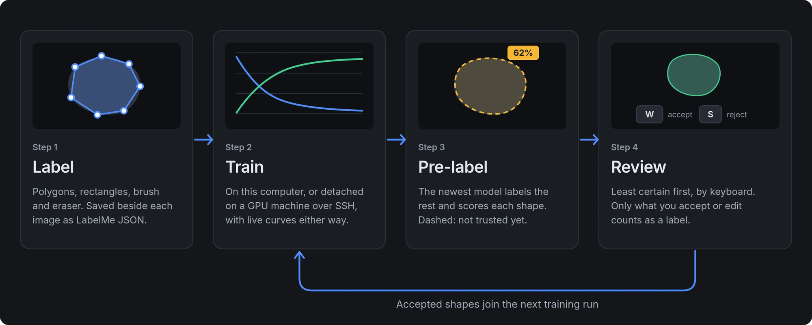
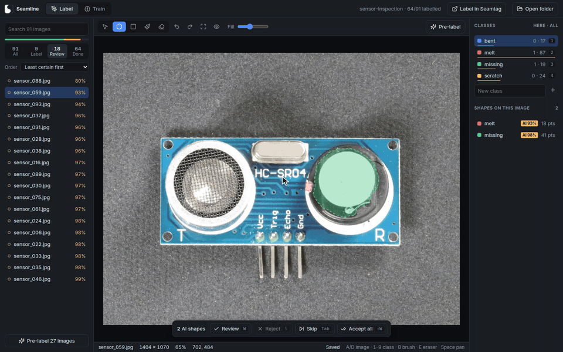
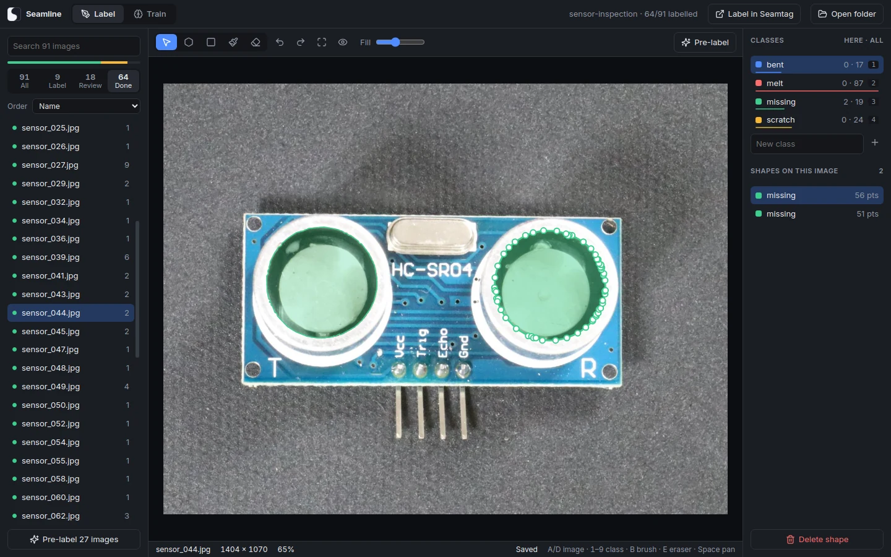
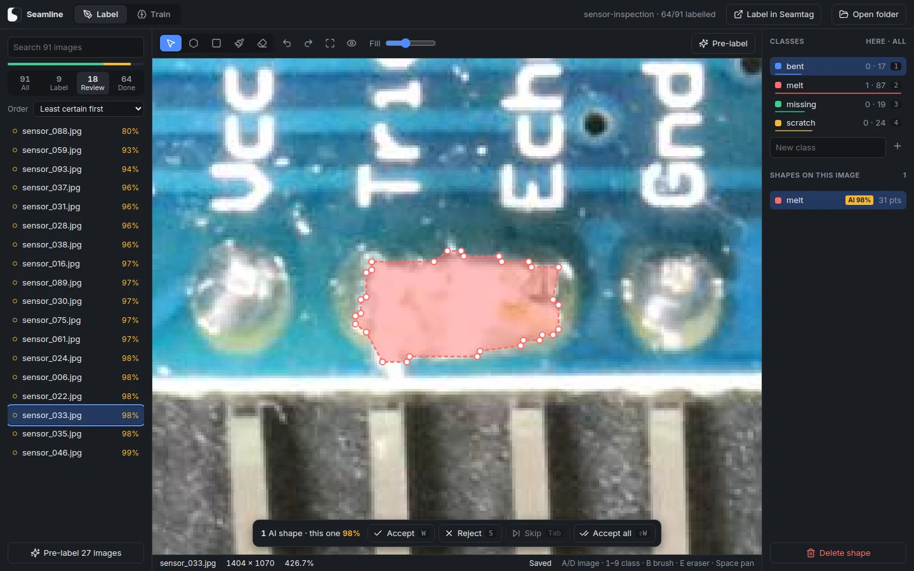
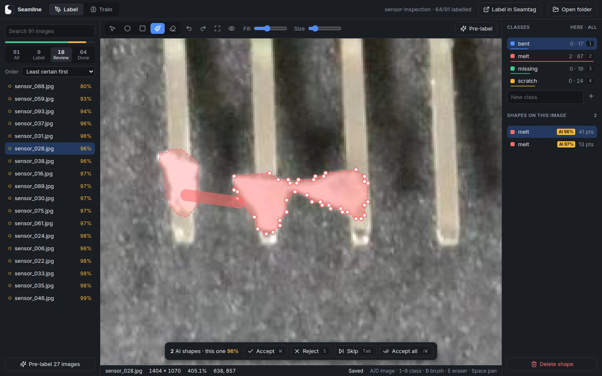
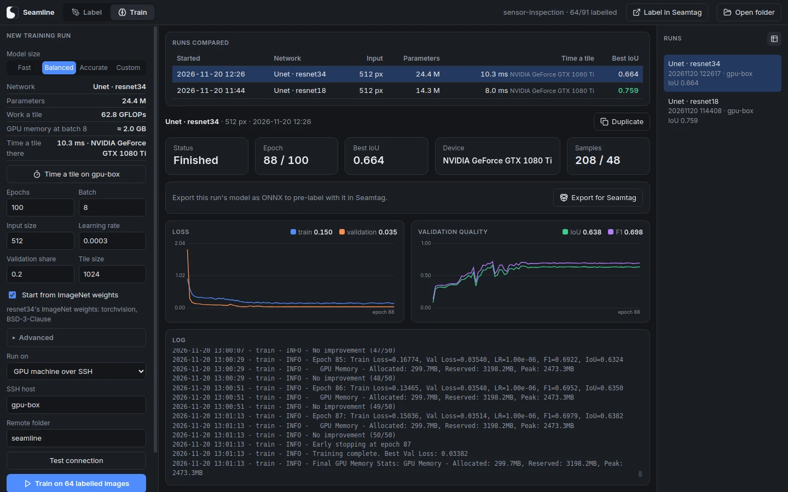
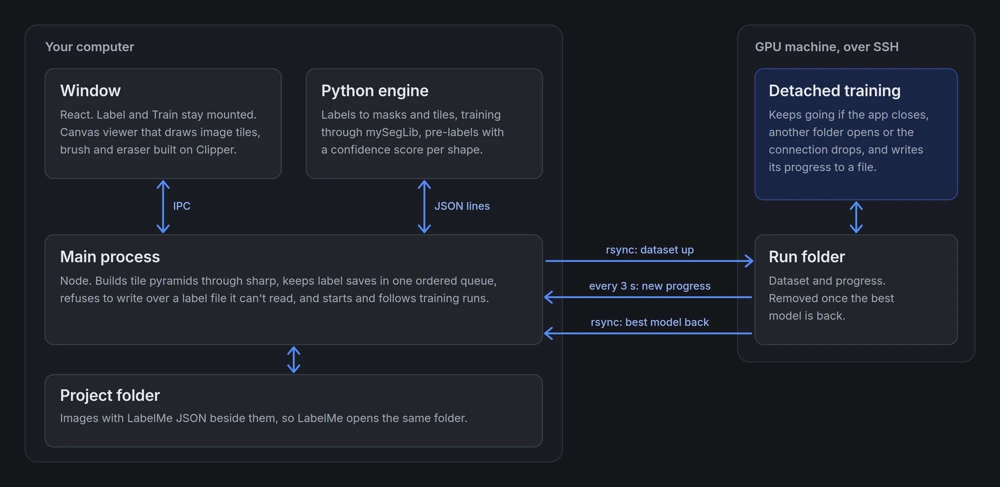
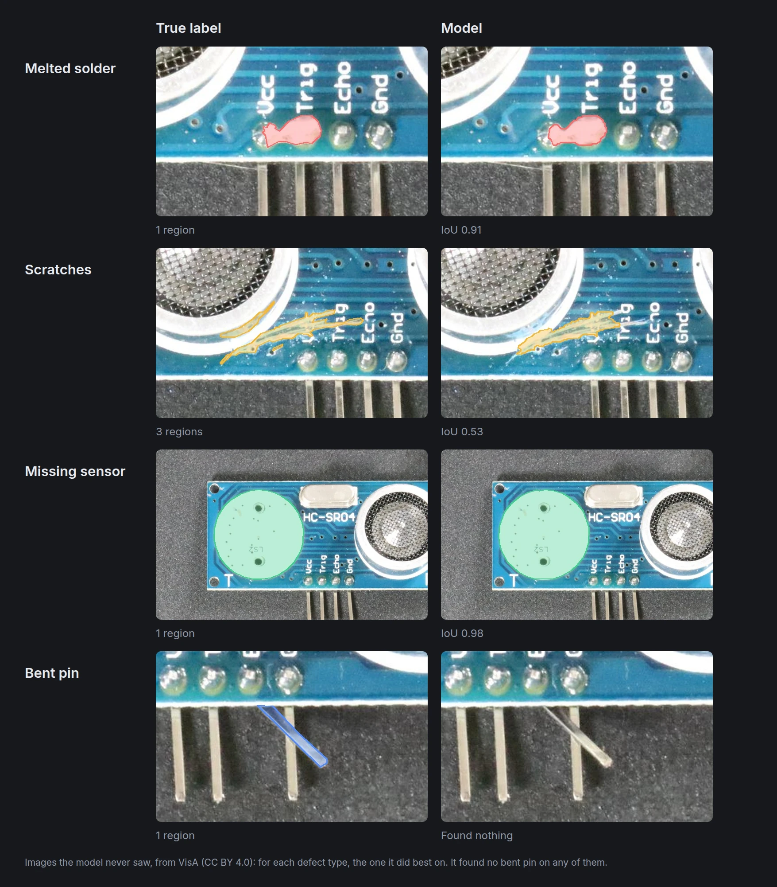

<p align="center">
  <picture>
    <source media="(prefers-color-scheme: dark)" srcset="docs/brand/seamline-logo-on-dark.svg">
    
  </picture>
</p>

<p align="center"><b>Label images and train segmentation models in one desktop app, on your own machines.</b></p>

<p align="center">
  <a href="https://github.com/jakhon37/Seamline/actions/workflows/tests.yml"></a>
  <a href="https://github.com/jakhon37/Seamline/actions/workflows/lint.yml"></a>
  <a href="LICENSE"></a>
</p>

<picture>
  <source media="(max-width: 700px)" srcset="docs/media/banner-phone.webp">
  <source media="(prefers-reduced-motion: reduce)" srcset="docs/media/banner.webp">
  
</picture>

Label some images, train, let the model label the rest, review what it proposed, least certain first, and train again on what you accepted. It all stays on your own machines: labels are plain LabelMe files beside your images, and training runs on this computer or on your GPU machine over SSH.

- **Review ordered by uncertainty.** Every proposed shape gets a confidence score, and you can work through the least certain first, accepting, rejecting or skipping by keyboard.
- **A model sized to the job.** Pick Fast, Balanced or Accurate, or choose among 11 architectures and 7 pretrained encoders under Advanced, and see its parameters, work per tile, training memory and speed before it trains. Runs line up in a table to compare, and Duplicate starts a variant of one.
- **Detached remote training.** A run on your GPU machine keeps going if you close the app or lose the connection, and the app picks it back up.
- **Tile pyramids for large images.** The viewer draws only the tiles on screen, from a pyramid built once with libvips.
- **mySegLib underneath.** Training goes through the library in this repo, built on PyTorch and segmentation_models_pytorch. It also works on its own, with multi-GPU DDP, chunked inference and ONNX export.

Seamline pairs with [Seamtag](https://github.com/jakhon37/Seamtag), a labelling app for Windows, macOS and Linux with labelme's and LabelImg's tools and AI that outlines an object from a click or a box. Seamline trains on the shapes Seamtag saves, in LabelMe, Pascal VOC, YOLO or CreateML files. **Label in Seamtag** opens the image you're on in Seamtag, **Export for Seamtag** gives it a trained model to pre-label with, and both apps can work in one folder at once.



## How it works

<picture>
  <source media="(max-width: 700px)" srcset="docs/media/workflow-phone.webp">
  
</picture>

## See it work



This is the real app on real images, driven by a script. The cursor and key labels are drawn on top for the recording. There's also an [MP4 version](docs/media/demo.mp4).

<table>
  <tr>
    <td width="50%"></td>
    <td width="50%"></td>
  </tr>
  <tr>
    <td><b>Label</b> with polygons, rectangles, a brush and an eraser</td>
    <td><b>Review</b> each proposal: <code>W</code> accept, <code>S</code> reject, <code>Tab</code> skip</td>
  </tr>
  <tr>
    <td></td>
    <td></td>
  </tr>
  <tr>
    <td><b>Touch up</b> with a brush, here joining two proposed pieces of one melt</td>
    <td><b>Train</b> here or on a GPU machine over SSH, and compare runs</td>
  </tr>
</table>

## How it's built



Seamline is an Electron app: a React window, a Node main process, and a Python engine that reports in JSON lines and trains through mySegLib.

- **Remote runs outlive the app.** A run starts on the GPU machine under `setsid nohup` and writes its progress to a file the app reads every 3 seconds. The app reattaches when the project opens, and when the run ends it fetches the best model and clears the run from the machine. It has trained on a real GTX 1080 Ti, and a stand-in for the machine tests the failure cases.
- **Only networks that train are offered.** The Train page offers networks from one list, and a test trains each architecture and encoder on it for a step, exports it to ONNX and checks onnxruntime's scores against PyTorch's.
- **Costs are counted before training.** The estimate builds the network on PyTorch's meta device, so counting its parameters, FLOPs and training memory takes about a second at any size.
- **Labels are hard to lose.** Saves go through one ordered queue, and a label file another app changed is reloaded, never written over.
- **Labels train as labelme draws them.** Tests check each shape's mask pixel for pixel against labelme's own code, and the Pascal VOC, YOLO and CreateML readers against Seamtag's.

[docs/ARCHITECTURE.md](docs/ARCHITECTURE.md) has the detail, from how proposals are scored to the tile pyramids.

## Tested on real images

The Balanced size, a Unet on ResNet-34, was trained through the app on 64 labelled photos of circuit boards from [VisA](https://github.com/amazon-science/spot-diff). On 27 photos it never saw, it found 22 of the 55 defects, with a mean IoU of 0.42 across the four defect types, and proposed nothing at all on 9 of the photos. Of its 25 proposals, 20 were on a defect of the right type, 1 on a defect of another type and 4 mostly off any defect. On 30 defect-free boards it proposed nothing. It's one run on a small set, so read the numbers as rough.



These are the model's best for each defect type, so they're better than average.

**What it still gets wrong.** With 64 labelled images, the model misses more than half of the defects and never finds a bent pin. A defect the model misses has no shape to review, so you still need to look at the images. How much labelling time this saves hasn't been measured.

[docs/demo](docs/demo/README.md) has the charts, how each number is counted, and how to reproduce them.

## Install

Download the installer for your system from [the latest release](https://github.com/jakhon37/Seamline/releases/latest): Windows 10 and 11, macOS on Apple silicon, or Linux, as a `.deb` or an AppImage. On first start, Seamline sets up its engine: Python and PyTorch in the build that fits your computer, from 0.3 GB to download for the CPU build to 3.9 GB for CUDA on an older NVIDIA GPU. The installers aren't signed, so Windows and macOS warn about them the first time. The [install guide](docs/INSTALL.md) says what to do then, how to set up a GPU machine to train on over SSH, and where disk space goes.

To run it from source instead, you need Git, Node.js 22 or later, and [uv](https://docs.astral.sh/uv/getting-started/installation/), which fetches Python if you don't have it:

```bash
git clone https://github.com/jakhon37/Seamline.git
cd Seamline
uv venv --python 3.12
uv pip install --torch-backend=auto -r requirements.txt
cd app
npm ci
npm run build
npm start
```

`--torch-backend=auto` installs PyTorch's CUDA build when the computer has an NVIDIA driver, and its much smaller CPU build when it hasn't; on an NVIDIA GPU from before the RTX 20 and GTX 16 series, write `cu126` in place of `auto`. [The app's guide](app/README.md) has the keys and how each part works.

## License and credits

MIT, see [LICENSE](LICENSE). Third-party notices are in [THIRD_PARTY_NOTICES.md](THIRD_PARTY_NOTICES.md), with the source and licence of each encoder's ImageNet weights, which training downloads and Seamline doesn't ship. The Pascal VOC, YOLO and CreateML readers in [`engine/studio.py`](engine/studio.py) and [`app/src/shared/formats.ts`](app/src/shared/formats.ts) are ported from [LabelImg](https://github.com/HumanSignal/labelImg) under the MIT License, and carry its notice.

Demo images are from [VisA](https://github.com/amazon-science/spot-diff) (Zou et al., ECCV 2022), used under [CC BY 4.0](https://creativecommons.org/licenses/by/4.0/) and shown cropped with labels drawn on them.

The banner at the top also shows images from [MVTec AD](https://www.mvtec.com/company/research/datasets/mvtec-ad) (Bergmann et al., CVPR 2019), under [CC BY-NC-SA 4.0](https://creativecommons.org/licenses/by-nc-sa/4.0/), and from [D-Fire](https://github.com/gaiasd/DFireDataset) (de Venâncio et al., 2022), released under [CC0 1.0](https://creativecommons.org/publicdomain/zero/1.0/). Because it contains MVTec AD images, the banner (`docs/media/banner*.webp`) is shared under CC BY-NC-SA 4.0, not MIT.
