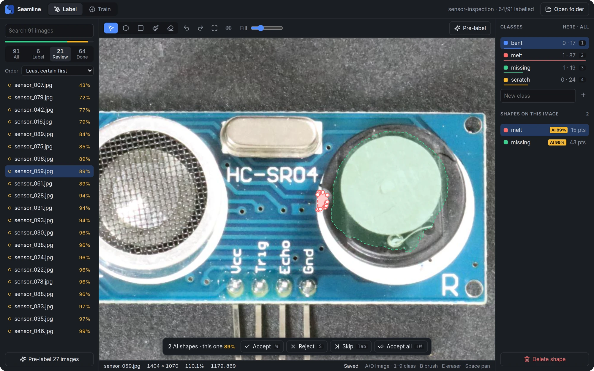
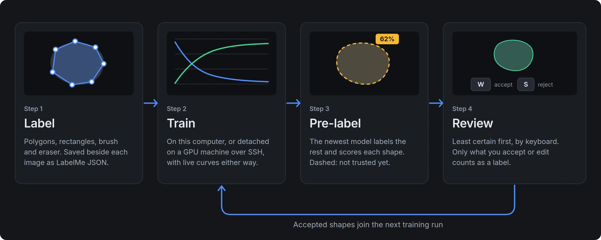
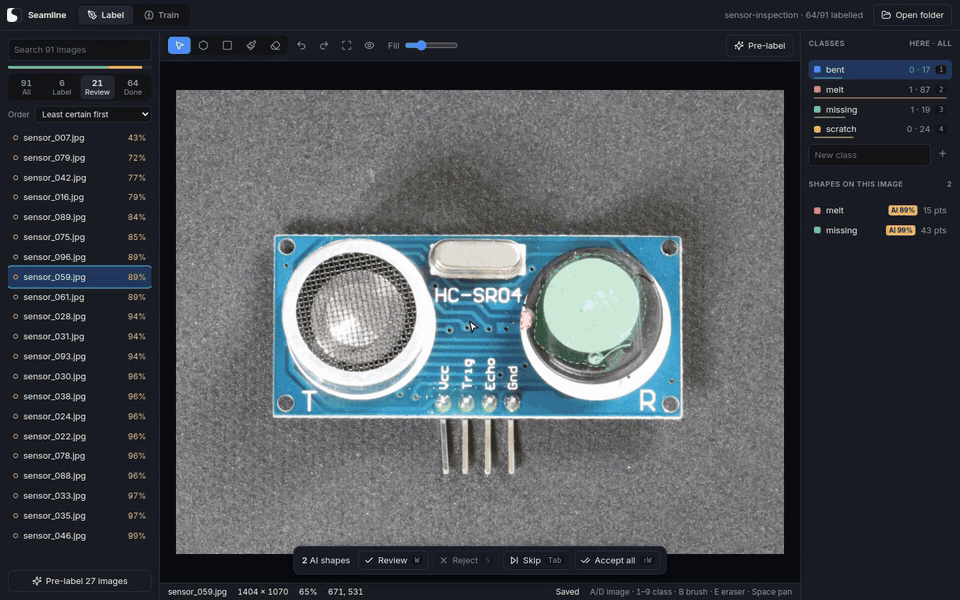
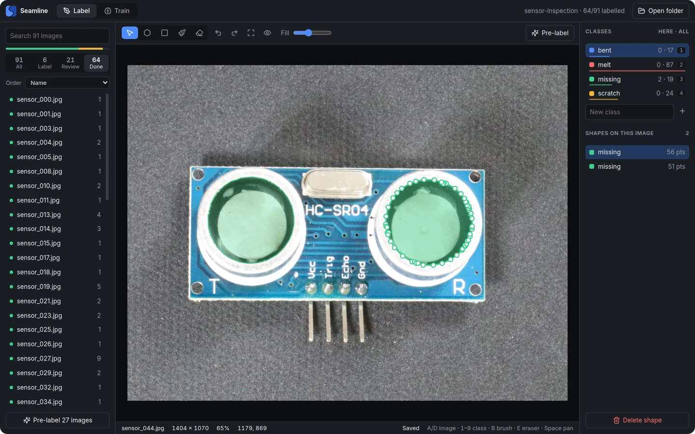
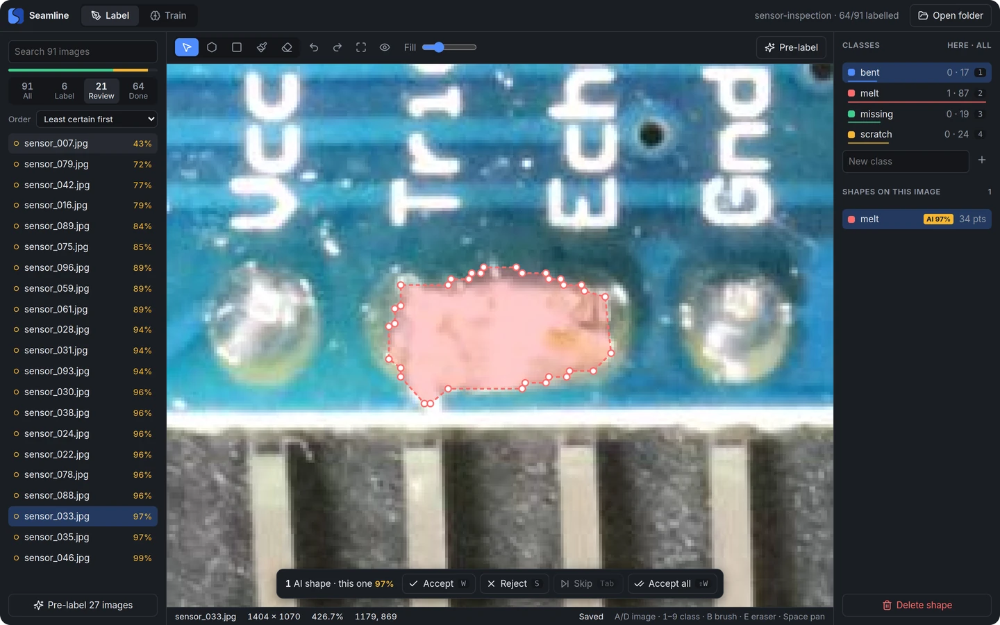
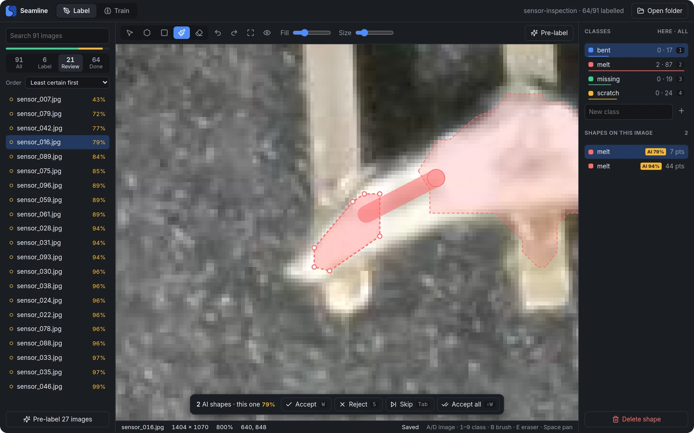
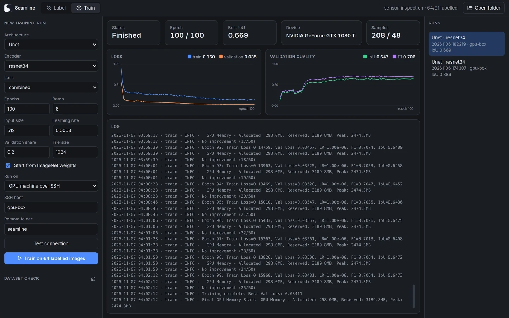
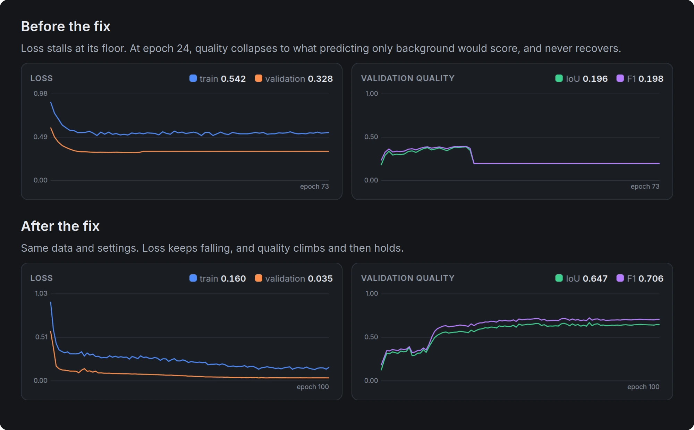
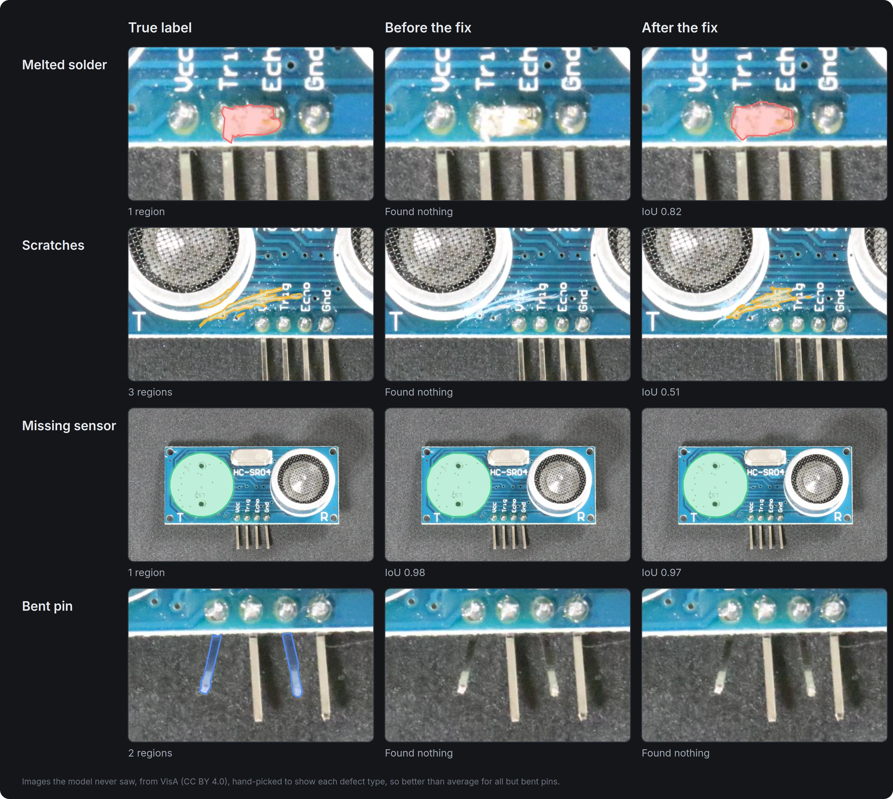
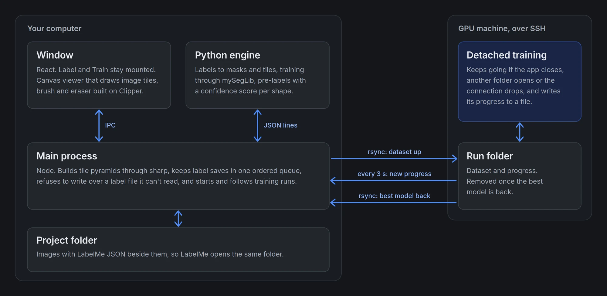

<p align="center">
  <picture>
    <source media="(prefers-color-scheme: dark)" srcset="docs/brand/seamline-logo-on-dark.svg">
    
  </picture>
</p>

<p align="center"><b>Label images and train segmentation models in one desktop app, on your own machines.</b></p>

<p align="center">
  <a href="https://github.com/jakhon37/Seamline/actions/workflows/tests.yml"></a>
  <a href="https://github.com/jakhon37/Seamline/actions/workflows/lint.yml"></a>
  <a href="LICENSE"></a>
</p>



Label some images, train, let the model label the rest, then review what it proposed, least certain first. Nothing is uploaded: labels stay as plain LabelMe files beside your images, and training runs on this computer or on your own GPU machine over SSH. Seamline is built on mySegLib, the library in this repo.

**Running it on real circuit-board photos exposed two silent bugs in the training code. One of them meant the model found 2 of 55 real defects instead of 24.** [See the results.](#tested-on-real-images)

## How it works

<picture>
  <source media="(max-width: 700px)" srcset="docs/media/workflow-phone.webp">
  
</picture>

## See it work



This is the real app on real images, driven by a script. The cursor and key labels are drawn on top for the recording. There's also an [MP4 version](docs/media/demo.mp4).

<table>
  <tr>
    <td width="50%"></td>
    <td width="50%"></td>
  </tr>
  <tr>
    <td><b>Label</b> with polygons, rectangles, a brush and an eraser</td>
    <td><b>Review</b> each proposal: <code>W</code> accept, <code>S</code> reject, <code>Tab</code> skip</td>
  </tr>
  <tr>
    <td></td>
    <td></td>
  </tr>
  <tr>
    <td><b>Touch up</b> with a brush, here joining two pieces of one melted pin</td>
    <td><b>Train</b> on a GPU machine over SSH, and compare runs</td>
  </tr>
</table>

## Tested on real images

Everything above comes from real runs on circuit-board photos from the [VisA dataset](https://github.com/amazon-science/spot-diff): four defect types, 64 labelled images, and 27 held back that the model never saw. The model is a Unet with a ResNet-34 encoder, trained through the app on a GTX 1080 Ti. The scripts and results are in [`docs/demo`](docs/demo/README.md).

Those runs found two silent bugs that synthetic tests had never shown:

1. **Softmax applied twice.** The configs put softmax on the model's output, and the losses apply it again. Even a perfect prediction then cost 0.30 on the combined focal and Dice loss, and no pixel could look more than 40% certain. Validation loss sat just above that floor, at 0.315, and quality later collapsed.
2. **Part of each image ignored.** Tiling dropped any leftover strip narrower than half a tile. On these 1404×1070 photos, 30% of every image never reached training, and on a 1500×1500 image it would be 53%.

Both are fixed, with tests.



The table isolates the softmax fix on the 27 unseen images. Both models have the tiling fix and the same data and training settings. It's one run each, so small differences mean little.

| On the 27 unseen images | Before | After |
|---|---:|---:|
| Real defects found (at least half covered) | 2 of 55 | **24 of 55** |
| Images with no proposal at all | 25 of 27 | 6 of 27 |
| Mean IoU across the four defect types | 0.18 | **0.41** |

The IoU here is over all pixels of each type. The app's Best IoU of 0.669 reads higher because it's on validation tiles and averages background in.

**Few false alarms.** Of the 31 proposals after the fix, 24 are on a defect and the right type, 3 are on a defect but the wrong type, and 4 are mostly off any defect. On 30 defect-free boards, it proposed only 1 shape.



These examples are hand-picked to show each defect type, so they're better than average for all but bent pins. The averages are in the chart:


The right-hand chart is why review goes least certain first. It's from only 31 shapes, so treat it as a direction rather than a measurement.

**What it still gets wrong.** With 64 labelled images, the model misses more than half of the defects and never finds a bent pin. Missing-sensor IoU also dropped slightly, from 0.72 to 0.65: both models found the same two of the five images, and the new model's outline on one of them is looser. A defect the model misses has no shape to review, so you still need to look at the images. How much labelling time this saves hasn't been measured.

## Under the hood



- **Labels are hard to lose.** Each save names its own folder and goes through one ordered queue, the last edit is flushed before the window closes, and a label file that can't be read is flagged and never written over. A dedicated code review found 10 real bugs across the app. All are fixed, most with a test written first.
- **Remote runs outlive the app.** Training keeps going if you close the app, open another folder or lose the connection, and the app picks it back up. A stand-in for the GPU machine tests the failure cases without needing a GPU, and the normal path has run on a real GTX 1080 Ti.
- **A crash only some CPUs hit.** Local training died at random on one AVX-only Xeon: 6 of 12 runs. The cause was a race in MKL's first vector-math call. One single-threaded call at import brought real runs to 0 of 30, and a stress loop to 0 of 6000. The obvious workaround, `MKL_ENABLE_INSTRUCTIONS=AVX`, only hides it: the same loop still crashed 578 times.
- **Geometry that survives fuzzing.** The first polygon library crashed under random brush strokes. Clipper replaced it, and the result was fuzzed against an independent model.
- **Large images open fast.** The viewer draws tile pyramids built with libvips: a 6050×12300 TIFF took 8 seconds to open the first time and 4 ms after that, on an older PC.

## Try it

You need Node 20+ and Python 3.10+. There's no installer yet, and it's only been tested on Linux.

```bash
git clone https://github.com/jakhon37/Seamline.git
cd mySegLib
python -m venv .venv && .venv/bin/pip install -r requirements.txt
cd app
npm install
npm run build
npm start
```

Open any folder of images. [`app/README.md`](app/README.md) has the keyboard shortcuts and how to train on a GPU machine.

## Still to do

- An installer, and testing on Windows and macOS
- A way to mark an image as truly empty: rejecting every shape sends it back to be pre-labelled again
- Training on clean images too: tiles with no defect are skipped today
- Review of the model's worst errors, not just its least certain shapes
- SAM-assisted labelling

## The library underneath

Seamline trains through mySegLib, which also works on its own from YAML configs and the command line: 9 architectures, multi-GPU training with DDP, chunked inference for huge images and ONNX export. See the [library guide](docs/LIBRARY.md).

## License and credits

MIT, see [LICENSE](LICENSE). Third-party notices are in [THIRD_PARTY_NOTICES.md](THIRD_PARTY_NOTICES.md).

Demo images are from [VisA](https://github.com/amazon-science/spot-diff) (Zou et al., ECCV 2022), used under [CC BY 4.0](https://creativecommons.org/licenses/by/4.0/) and shown cropped with labels drawn on them.
