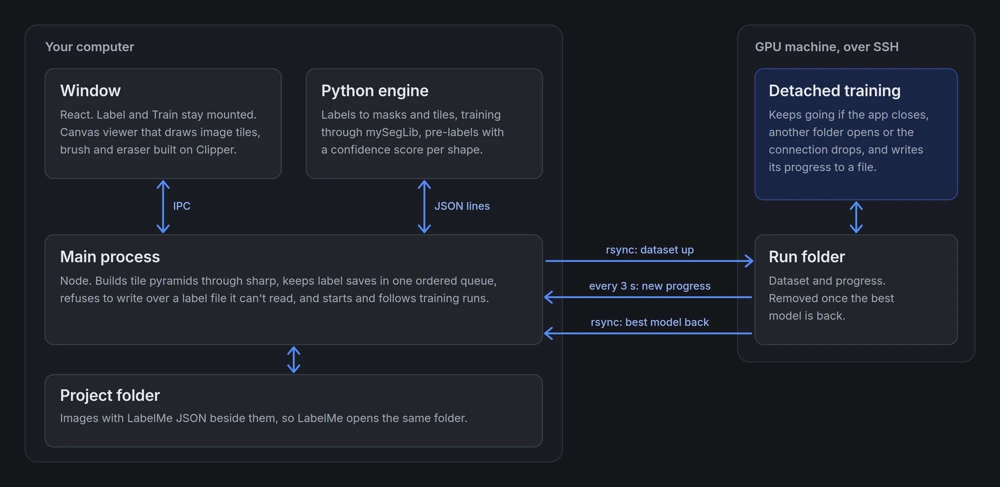

# How Seamline is built

Seamline is an Electron app: a React window, a Node main process, and a Python engine that reports in JSON lines and trains through mySegLib, the library in this repository. [The app's guide](../app/README.md#how-it-fits-together) says where each part's code is.

## Pre-labelling and review

Pre-labelling runs the newest model on every image with no label file, or a LabelMe file with only AI shapes, and saves as it goes. A shape's score is [the model's mean confidence inside it](../engine/studio.py), which is good for ranking but isn't a probability. Each image's shapes are reviewed least certain first, and the **Least certain first** order sorts the images the same way. Proposals stay out of training until you accept or edit them.

## Training

- **Remote runs outlive the app.** [The app](../app/src/main/index.ts) checks the machine's GPU and disk, uploads the dataset with rsync and starts training with `setsid nohup`. The run writes its progress to a file the app reads every 3 seconds, so closing the app, opening another folder or losing the connection doesn't touch it. When the project opens, the app reattaches. When the run ends, the best model comes back and the run's files are removed from the machine. [A stand-in for the GPU machine](../app/e2e/fake_gpu.ts) tests the failure cases without needing a GPU, and the normal path has run on a real GTX 1080 Ti.
- **Training goes through mySegLib.** The engine turns label files into masks and tiles, then trains through the library's `scripts/train.py`. The library also works on its own from YAML configs and the command line: see the [library guide](LIBRARY.md).
- **Only networks that train are offered.** The Train page's choices come from [one list](../app/src/shared/models.json), and [a test](../tests/unit/test_model_choices.py) reads the same list: for every architecture and encoder on it, and each encoder depth, decoder width and attention it offers, it trains a step on a tiny dataset, exports to ONNX and checks onnxruntime's scores against PyTorch's. Every combination was tried first on segmentation_models_pytorch 0.6.0, and what fails is left out: DenseNet under DeepLabV3, DeepLabV3+ and PAN, and other depths for FPN and PSPNet, whose heads upsample by a fixed factor. SegFormer's own MiT encoders are left out too, as their weights are for non-commercial use only. The engine refuses the same settings, and a run keeps its network's shape in its config, so pre-labelling and export build what it trained.
- **Costs are counted before training.** [The estimate](../src/models/estimate.py) builds the network on PyTorch's meta device, where tensors have shapes but no data, so counting its parameters, its FLOPs per tile and the tensors a training step keeps for the backward pass takes about a second whatever its size. Only the time per tile is measured for real, on a copy with zeros for weights. The app keeps the engine loaded between estimates, so only the first waits for PyTorch, and it can time a tile on the GPU machine too.

## Images and labels

- **Large images open fast.** Large images and TIFFs get a pyramid built once with libvips and reused until the file changes, and the viewer draws only the tiles on screen. On an older PC, a 6050×12300 test TIFF took 8 seconds to build its pyramid, and after that the open call returned in 4 ms.
- **Labels train as Seamtag and labelme read them.** The engine and the app look for each image's labels beside it, in the order Seamtag looks: `name.json` (LabelMe, or a CreateML list), `name.xml` (Pascal VOC), then `name.txt` beside a `classes.txt` (YOLO). The Pascal VOC, YOLO and CreateML readers are ported from LabelImg, and [tests](../tests/unit/test_studio_formats.py) compare what the engine reads from LabelImg's own files with what Seamtag's code reads. [Another test](../tests/unit/test_studio_shapes.py) checks the mask of each kind of shape with an area against the one labelme 7.9.1's own code draws, pixel for pixel. Lines and points have no area, so the dataset check counts them and leaves them out.
- **Labels are hard to lose.** Each save names its own folder and goes through one ordered queue, the last edit is flushed before the window closes, and a label file that can't be read is flagged and never written over. Nor is one that another app changed since Seamline read it: Seamline compares the file's content before writing, so a change that keeps its size and time counts too, and when it differs Seamline reloads the labels and says so.
- **Geometry checked against an independent model.** The brush and eraser merge and cut polygons with Clipper. [A seeded test](../app/e2e/geometry.spec.ts) runs 150 random paint and erase strokes and checks over 10,000 points against an independent model.

## Working with Seamtag

**Export for Seamtag** writes a run's model as ONNX, beside a `model.json` that gives its classes, input size, tile and the normalisation it trained with: the settings Seamline's own pre-labelling uses. An export is saved only if onnxruntime's scores match PyTorch's to within 0.001, or 0.1% of the largest score when that's more, and the `model.json` goes last, so Seamtag 3.3 and later, which list exported runs, never list half an export.

## The library

mySegLib, under the engine, has [its own guide](LIBRARY.md): training from YAML configs on one GPU or several, evaluation, chunked inference and ONNX export.
