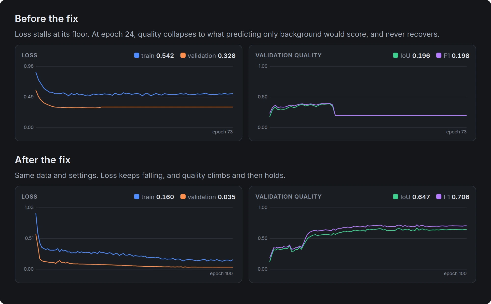
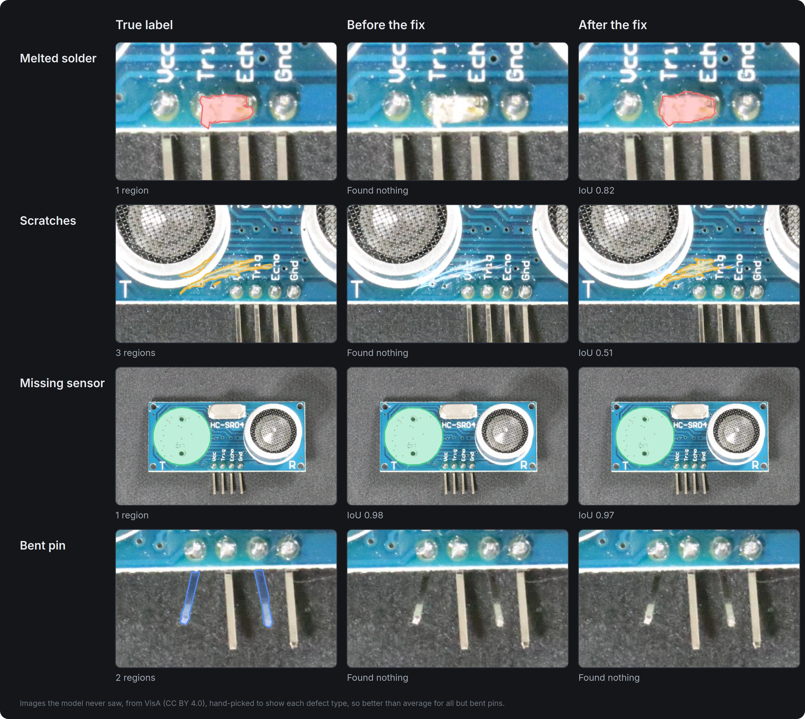
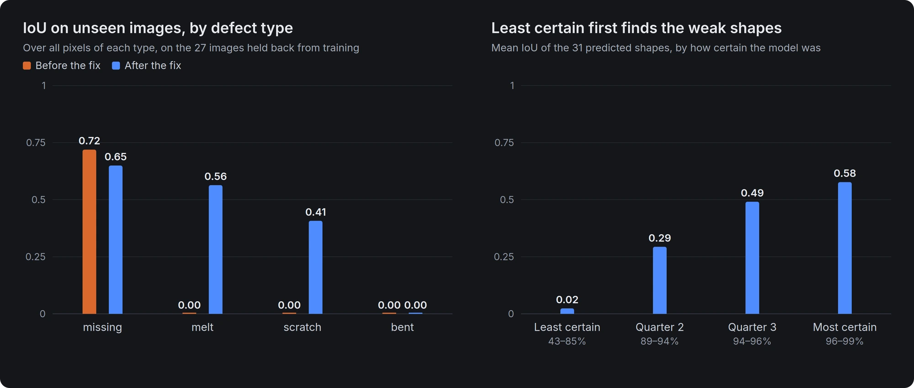

# Reproducing the demo numbers

The figures in the main README come from one real run through the app. Results are in [`results.json`](results.json).

## Data

`pcb1` from [VisA](https://github.com/amazon-science/spot-diff) (CC BY 4.0): photos of a circuit board with four defect types. The 91 images with a single defect type are used, split per type: 64 labelled from their true masks and 27 held back.

```bash
python docs/demo/build_project.py VisA/pcb1 demo/pcb demo/truth
```

## Run

Open `demo/pcb` in Seamline and train with these settings. This run used a GTX 1080 Ti over SSH.

| Setting | Value |
|---|---|
| Architecture, encoder | Unet, resnet34 with ImageNet weights |
| Loss | combined |
| Epochs, batch | 100, 8 |
| Input size, tile size | 512, 1024 |
| Learning rate | 0.0003 |
| Validation share | 0.2 |

Then press **Pre-label 27 images**, and score the result against the held-back labels:

```bash
python docs/demo/evaluate.py demo/pcb demo/truth results.json
```

Last, run the model on 30 defect-free boards it never saw, where every shape is a false alarm:

```bash
python docs/demo/clean_boards.py VisA/pcb1 demo/pcb demo/clean clean.json
```

## Reading the numbers

- A true defect counts as found when shapes of its class cover at least half of it.
- Per-class IoU is over all pixels of that class on the 27 images, without background. The app's **Best IoU** is different: it's on the validation tiles, and averages background in.
- A proposal counts as on a defect when at least half of it lies on a true defect of any type.
- 27 images and 31 predicted shapes is a small sample, so small differences mean little.
- "Before" is the same run on the code from before the softmax fix, with the tiling fix already in. Its validation IoU peaked at 0.389 and collapsed to 0.196 by epoch 24. After the fix it reached 0.669.

## What these runs changed

These runs found two silent bugs that synthetic tests had never shown:

1. **Softmax applied twice.** The configs put softmax on the model's output, and the losses apply it again. Even a perfect prediction then cost 0.30 on the combined focal and Dice loss, and no pixel could look more than 40% certain. Validation loss sat just above that floor, at 0.315, and quality later collapsed.
2. **Part of each image ignored.** Tiling dropped any leftover strip narrower than half a tile. On these 1404×1070 photos, 30% of every image never reached training, and on a 1500×1500 image it would be 53%.

Both are fixed, with tests.



The table isolates the softmax fix on the 27 unseen images. Both models have the tiling fix and the same data and training settings. It's one run each, so small differences mean little.

| On the 27 unseen images | Before | After |
|---|---:|---:|
| Real defects found (at least half covered) | 2 of 55 | **24 of 55** |
| Images with no proposal at all | 25 of 27 | 6 of 27 |
| Mean IoU across the four defect types | 0.18 | **0.41** |





Missing-sensor IoU also dropped slightly, from 0.72 to 0.65: both models found the same two of the five images, and the new model's outline on one of them is looser.
