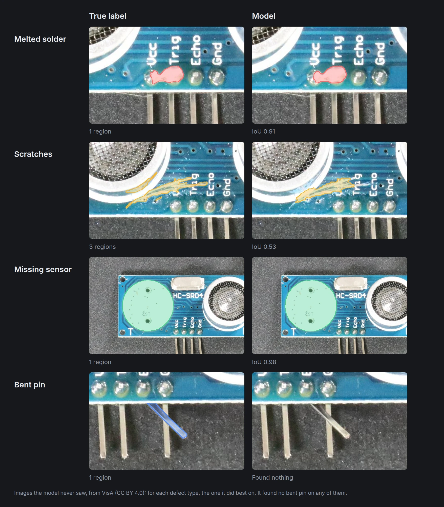
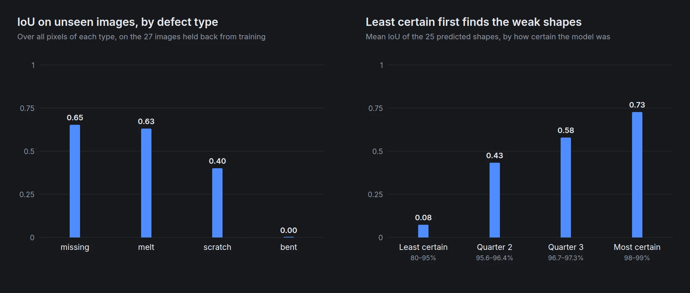
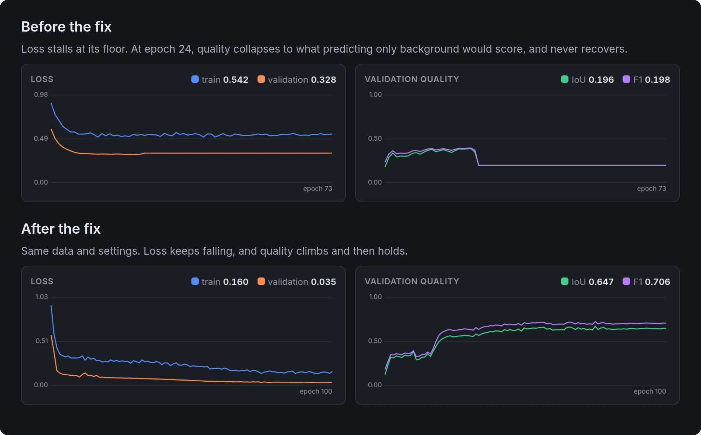
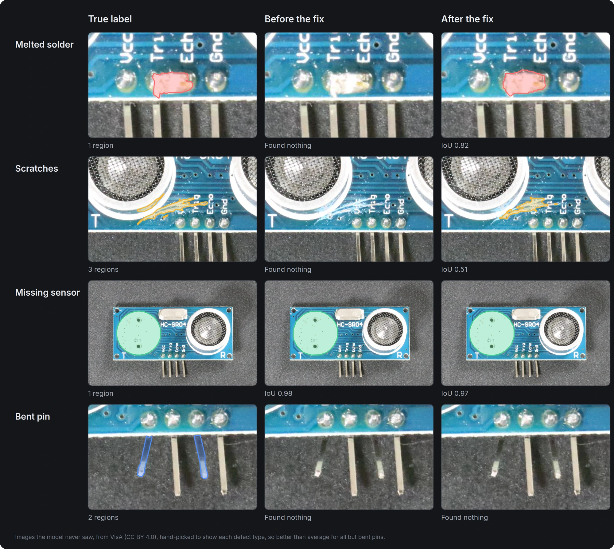
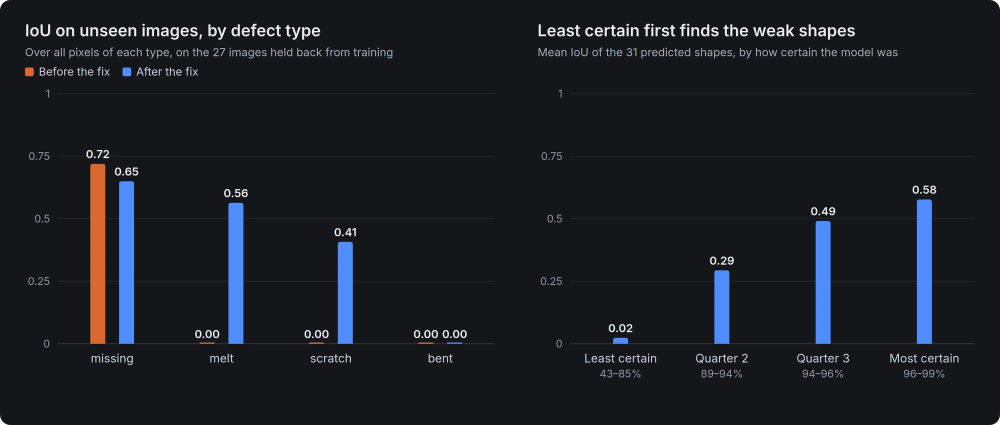

# Results on real images

The figures on this page, and the screenshots and demo in the main README, come from one project and two real runs through the app, made on 2026-11-20. The figures are in [`results.json`](results.json). The fix history at the end comes from the runs of 2026-11-06, in [`results-2026-11-06.json`](results-2026-11-06.json).

## What was tested

Circuit-board photos from the [VisA dataset](https://github.com/amazon-science/spot-diff): four defect types, 64 labelled images, and 27 held back that the model never saw. The model is a Unet with a ResNet-34 encoder, the Balanced size, trained through the app on a GTX 1080 Ti. It's one run on a small set, so read the numbers as rough.

## Results

On the 27 unseen images, all with defects, the model found 22 of the 55 defects (at least half of each covered), proposed nothing on 9 images, and reached a mean IoU of 0.42 across the four defect types. That IoU is over all pixels of each type. The app's Best IoU of 0.664 reads higher because it's on validation tiles and averages background in.

**Mostly right when it proposes.** Of the 25 proposals, 20 are on a defect and the right type, 1 is on a defect but the wrong type, and 4 are mostly off any defect. On 30 defect-free boards, it proposed nothing.



These examples are the model's best for each defect type, so they're better than average, and it found no bent pin at all. The averages are in the chart:



The right-hand chart is the case for reviewing least certain first: low scores go with weak shapes (Spearman 0.75 between score and IoU). It's from only 25 shapes, so treat it as a direction rather than a measurement.

**What it still gets wrong.** With 64 labelled images, the model misses more than half of the defects and never finds a bent pin. A defect the model misses has no shape to review, so you still need to look at the images. How much labelling time this saves hasn't been measured.

## How the numbers are counted

- A true defect counts as found when shapes of its class cover at least half of it.
- Per-class IoU is over all pixels of that class on the 27 images, without background. The app's **Best IoU** is different: it's on the validation tiles, and averages background in.
- A proposal counts as on a defect when at least half of it lies on a true defect of any type, and of the right type when at least half of it lies on its own type.
- Certainty quarters split the proposals by score, the last taking any left over.
- 27 images and 25 predicted shapes is a small sample, so small differences mean little.

## Reproducing them

### Data

`pcb1` from [VisA](https://github.com/amazon-science/spot-diff) (CC BY 4.0): photos of a circuit board with four defect types. The 91 images with a single defect type are used, split per type: 64 labelled from their true masks and 27 held back.

```bash
python docs/demo/build_project.py VisA/pcb1 sensor-inspection truth
```

### Run

Open `sensor-inspection` in Seamline and train with these settings, on a GPU machine over SSH. These runs used a GTX 1080 Ti.

| Setting | Value |
|---|---|
| Model size | Balanced: Unet, resnet34 with ImageNet weights |
| Loss | combined |
| Epochs, batch | 100, 8 |
| Input size, tile size | 512, 1024 |
| Learning rate | 0.0003 |
| Validation share | 0.2 |

The run stopped at epoch 88, 50 epochs after its best validation loss, with a best IoU of 0.664. A Fast run, Unet on resnet18 with the same settings, came first so that the Balanced run is the newest, which is the one pre-labelling uses. It reached 0.759, and the two sit side by side in the README's screenshot of the Train page. `train_runs.cjs` trains both through the app.

Then press **Pre-label 27 images**, and score the result against the held-back labels:

```bash
python docs/demo/evaluate.py sensor-inspection truth results.json
```

Last, run the model on 30 defect-free boards it never saw, where every shape is a false alarm:

```bash
python docs/demo/clean_boards.py VisA/pcb1 sensor-inspection clean clean.json
```

### The README's images

The charts are drawn from `results.json`, and the screenshots and demo are the real app on the project, driven by scripts. The scripts take a project, an app profile of their own so nothing reaches yours, and a display such as Xvfb. The demo is filmed from that display with ffmpeg, and the cursor and keys are drawn by the page as the script moves and presses them.

```bash
python docs/demo/build_charts.py results.json sensor-inspection truth docs/media
node docs/demo/shoot.cjs prelabel sensor-inspection profile
node docs/demo/shoot.cjs stills sensor-inspection profile docs/demo/stills.json shots
node docs/demo/record_demo.cjs sensor-inspection profile docs/demo/demo.json demo.mp4
```

[`stills.json`](stills.json) and [`demo.json`](demo.json) say which images, shapes and steps. A still that edits labels, such as the brush stroke, is best taken last, or from a fresh copy of the project, so the others show the folder as it was.

## What the first runs changed

The first runs on this project, on 2026-11-06, found two silent bugs that synthetic tests had never shown:

1. **Softmax applied twice.** The configs put softmax on the model's output, and the losses apply it again. Even a perfect prediction then cost 0.30 on the combined focal and Dice loss, and no pixel could look more than 40% certain. Validation loss sat just above that floor, at 0.315, and quality later collapsed.
2. **Part of each image ignored.** Tiling dropped any leftover strip narrower than half a tile. On these 1404×1070 photos, 30% of every image never reached training, and on a 1500×1500 image it would be 53%.

Both are fixed, with tests. "Before" below is the same run on the code from before the softmax fix, with the tiling fix already in. Its validation IoU peaked at 0.389 and collapsed to 0.196 by epoch 24. After the fix it reached 0.669.



The table isolates the softmax fix on the 27 unseen images, from the runs of 2026-11-06. Both models have the tiling fix and the same data and training settings. It's one run each, so small differences mean little.

| On the 27 unseen images | Before | After |
|---|---:|---:|
| Real defects found (at least half covered) | 2 of 55 | **24 of 55** |
| Images with no proposal at all | 25 of 27 | 6 of 27 |
| Mean IoU across the four defect types | 0.18 | **0.41** |





Missing-sensor IoU also dropped slightly, from 0.72 to 0.65: both models found the same two of the five images, and the new model's outline on one of them is looser.
